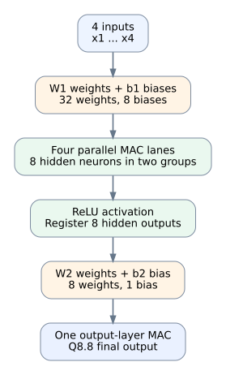
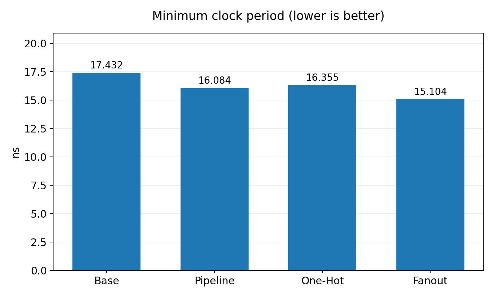

# Design and Comparative Evaluation of a MAC-Based FPGA Neural-Network Inference Accelerator

This project implements and evaluates a VHDL-based, MAC-oriented accelerator for feed-forward neural-network inference on FPGA. Its main contribution is a controlled comparison of four RTL variants built around the same four-MAC datapath and reference workload. The experiments examine how output-layer organization, input-buffer read selection, and address-register structure affect internal timing and logic-resource use.

The evaluated workload is a fully connected **4–8–1 multilayer perceptron (MLP)**: four inputs, eight hidden neurons with ReLU activation, and one output. This is the current integrated reference design used for the reported comparison. Some lower-level modules use generics, but the complete top-level is not a general-purpose engine for arbitrary network topologies.



## What is compared

- **Base:** four parallel MAC lanes in the hidden layer, followed by a sequential output-layer MAC.
- **Pipeline:** registered stages in the output-layer operand selection, multiplication, and accumulation path.
- **One-Hot:** decoded one-hot control and mask/OR logic for the four-entry input-buffer read selection.
- **Address replication (historically called Fanout):** a separate registered input-buffer read address, intended to change the address/control path without adding an arithmetic pipeline stage.

One-MAC and two-MAC reference implementations are also included to provide additional architectural and cycle-count context. The central focus is the design trade-off between these specific RTL organizations—not a claim that one structure is universally best for every network or FPGA.

## Archived implementation results

The table summarizes archived Xilinx ISE reports for Spartan-3 `xc3s400-4-pq208` with a 16.5 ns internal clock constraint. Values describe the recorded reference configuration; they are not fresh builds or board measurements.

| Variant | Main change | Minimum period (ns) | Setup slack (ns) | Compute window (cycles) | Slices | FFs | LUT4 | MULT18X18 | 16.5 ns constraint |
|---|---|---:|---:|---:|---:|---:|---:|---:|---|
| [Base](architectures/base-4mac/) | Sequential output layer | 17.432 | -0.932 | 17 | 967 | 782 | 1377 | 6 | Fail |
| [Pipeline](architectures/pipeline-4mac/) | Pipelined output layer | 16.084 | +0.416 | 19 | 986 | 849 | 1406 | 6 | Pass |
| [One-Hot](architectures/one-hot-4mac/) | One-hot input selection | 16.355 | +0.145 | 19 | 1019 | 911 | 1410 | 6 | Pass; slower than Pipeline |
| [Address replication (Fanout)](architectures/address-replication-4mac/) | Separate buffer read-address register | **15.104** | **+1.396** | 19 | 994 | 853 | 1419 | 6 | **Pass; best reported period** |



In the archived run, address-register replication reduced the minimum period by **0.980 ns (about 6.1%)** relative to Pipeline, at the cost of 8 additional slices, 4 FFs, and 13 LUT4s. The multiplier primitive count remained six. The One-Hot variant met the internal constraint, but it was slightly slower than Pipeline and used more slices and flip-flops.

`Compute window` is the cycle count recorded for the documented reference simulation scenario. It is not the same as end-to-end latency, initiation interval, or measured board throughput. A supplementary report records 31-cycle cached-input and 35-cycle input-reload intervals, but the original testbench/transcript required to independently recreate those figures is not included; treat them as historical claims rather than newly reproduced results.

See [the architecture overview](docs/architecture.md), [the results and limitations](docs/results.md), [design scope](docs/implementation-scope.md), and [the reproduction guide](docs/reproduction.md) for interpretation and instructions.

## Repository contents

```text
architectures/       # RTL, testbenches, project inputs, and evidence per variant
assets/              # architecture diagrams and comparison charts
docs/                # architecture, fixed-point, results, and reproduction notes
reference-model/     # MATLAB reference model, parameters, test vectors, analysis
scripts/             # repository checks and maintenance utilities
```

Each architecture directory preserves the RTL and project files associated with that variant. Some files are intentionally duplicated across variants so each historical result remains tied to the corresponding source snapshot.

## Reproduce the software reference analysis

Requirements: Python 3.10 or newer, NumPy, and SciPy.

```bash
python -m pip install -r reference-model/matlab/analysis/requirements-analysis.txt
python reference-model/matlab/analysis/compute_analysis.py --strict-existing-match --no-figures
```

This command recomputes fixed-point inference from the saved MATLAB model and verifies the archived 240-row analysis CSV. It is a software-reference calculation, not an RTL simulation.

For archived HDL checks and implementation flows, see [the reproduction guide](docs/reproduction.md). The Xilinx ISE and ModelSim projects are included, but were not rerun when this repository was curated.

## Evidence and limitations

- Archived ModelSim transcripts document only their recorded scenarios; they are not a formal equivalence proof and do not validate every possible configuration.
- The Python numerical analysis can be independently reproduced from the saved model and matches all numeric fields in the archived CSV.
- Current UCF files do not provide complete board-level I/O pin and timing constraints.
- No physical FPGA board test, measured power result, bitstream-to-board validation, or board-level performance result is claimed.
- Timing and resource values depend on the reference RTL, target device, constraints, and archived tool run. Any changed configuration requires fresh functional simulation and implementation reports.

## License

Released under the [MIT License](LICENSE).
