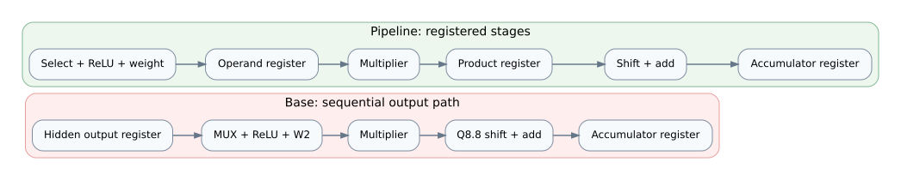
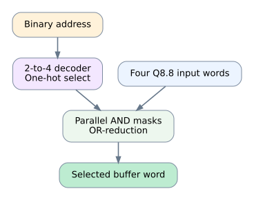
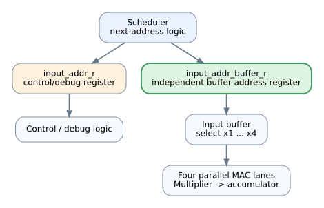

# Architecture overview

## Architectural goal

This repository documents a **VHDL design and comparative evaluation of a MAC-based FPGA neural-network inference datapath**. Its focus is the impact of specific RTL choices—compute-lane scheduling, output-layer pipeline boundaries, input-buffer selection, and address-register structure—on timing and logic-resource use.

The 4–8–1 network described below is the **integrated reference workload used for the controlled comparison**. It keeps the functional scenario consistent while the RTL variants change selected microarchitectural features. The current top-level remains specific to this network shape.

## Reference network and datapath

The benchmark is a fully connected 4–8–1 multilayer perceptron. The hidden layer has eight neurons and ReLU activation. Four MAC lanes evaluate the hidden layer in two groups; the output layer combines the eight hidden activations with eight output weights and one bias.

The implementation uses signed Q8.8 data. Multiplication is followed by an arithmetic right shift by eight bits before each product is accumulated. See [fixed-point format](fixed-point.md) for the software reference model's explicit arithmetic behavior.

## Architectural variants

### Base — sequential output

The four-MAC hidden layer is followed by a sequential output MAC. This is the baseline for the timing comparison and has the longest reported internal minimum period among the four main variants.

### Pipeline — registered output stages

The output calculation is divided into registered stages around operand selection, multiplication, and accumulation. This reduces the reported critical-path period at the expense of extra registers and a longer documented compute window.

### One-Hot — input-buffer selection

The four-word input buffer uses decoded one-hot selection and parallel mask/OR logic in the four-input case. A fallback path is retained for other input counts. The archived equivalence test covers input counts 4, 5, 17, and 21. In the archived implementation, this variant passes the 16.5 ns internal constraint but is slower than the pipelined baseline and uses more slices and flip-flops.

### Fanout — address-register replication

The scheduler's address register is separated from the input-buffer read-address register. The goal is to alter the control/address path and its routing behavior; this does not add a new arithmetic stage. The archived reports show the best minimum period of the four variants in the comparison table.

## Reference architectures

`architectures/reference-1mac/` and `architectures/reference-2mac/` preserve sequential and two-lane reference designs for cycle-count and architecture context. Their target constraints and historical reports are not interchangeable with the four-way timing comparison; do not compare their reported values without reviewing the device, constraints, and implementation conditions.

## What is and is not generic today

Some scheduler/control modules expose generics such as `NUM_INPUTS` and `NUM_NEURONS`, and selected input-selection logic is tested with multiple input counts. However, the complete integration is not yet uniformly parameterized: the reference top-level, hidden-neuron interface, and output-layer implementation contain explicit 4–8–1 sizing assumptions.

Accordingly, describe the project as a MAC-based inference RTL design with a comparative study of architectural trade-offs. Do not present it as a general-purpose engine that already accepts arbitrary layer dimensions. See [design scope](implementation-scope.md) for the current implementation boundary and potential follow-up work.
