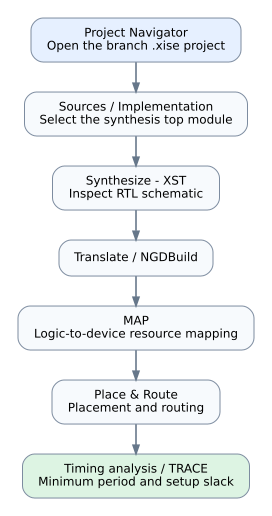

# Reproduction guide

This repository preserves project files and historical evidence. Tool-specific builds must be run in a compatible environment to obtain fresh hardware implementation results.

## 1. Reproduce the software fixed-point analysis

Install Python 3.10 or newer, then run from the repository root:

```bash
python -m pip install -r reference-model/matlab/analysis/requirements-analysis.txt
python reference-model/matlab/analysis/compute_analysis.py --strict-existing-match --no-figures
```

The script loads `MLP_reference.mat`, recomputes floating-point and Q8.8 outputs for 240 stored samples, and checks the results against the archived CSV. It is a numerical software reference, not a VHDL simulation.

## 2. Run archived ModelSim tests

The test scripts are branch-specific. Use ModelSim SE-64 2020.4 or a compatible simulator with VHDL-2002 support and run `.do` scripts from the branch root.

### One-Hot branch

```tcl
do scripts/run_one_hot_buffer_equivalence.do
do scripts/run_full_network_regression.do
```

Evidence for the historical run is in `architectures/one-hot-4mac/reports/ModelSim/`.

### Fanout branch

```tcl
do scripts/run_scheduler_replica_equivalence.do
do scripts/run_full_network_regression.do
```

Evidence for the historical run is in `architectures/address-replication-4mac/reports/ModelSim/`.

The other architecture branches also contain their respective scripts. Review each branch's `scripts/` directory and use its own project files. Historical PASS transcripts do not prove scenarios beyond the assertions recorded in them.

## 3. Run Xilinx ISE 14.7 implementation

Open the `.xise` project under the target branch's `project/` directory, or invoke the supplied Windows batch scripts from an Xilinx ISE Design Suite Command Prompt. The build scripts and `.xst` options are branch-specific.

For a new run:

1. Copy the selected branch to a clean working directory or save generated files to a separate output folder.
2. Open the branch's `.xise` project and confirm the intended synthesis top.
3. Run XST, then Translate, MAP, Place & Route, and TRACE.
4. Save new reports separately from `reports/historical/` or `reports/ise/` so the archived evidence remains unchanged.
5. Compare the new target device, speed grade, constraints, and tool settings before treating the run as comparable with the published table.

The workflow is illustrated below.



## What has not been rerun here

The Xilinx ISE and ModelSim project files were not executed during preparation of this repository. The available Python numerical analysis is independently reproducible; the reported FPGA timing and resource results are historical artifacts from the included reports.
